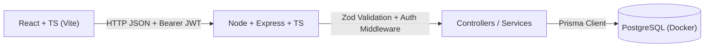
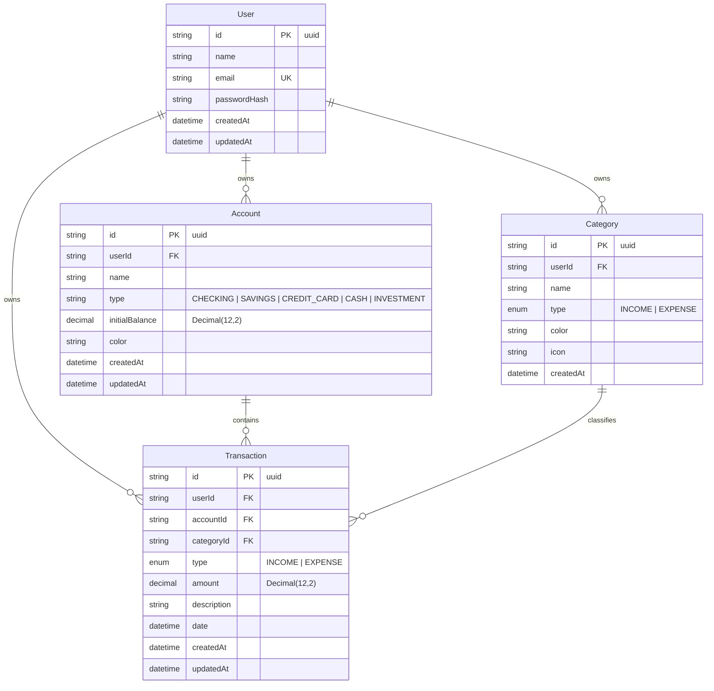

# PRD — Controle de Finanças Pessoais (`financial-control`)

> **Status:** Concluído (Etapas 0 a 11 finalizadas)  
> **Tipo:** Aplicação Full-Stack Web (Portfólio — Destaque A)  
> **Repositório:** `https://github.com/rodrigokk1975/financial-control`

---

## 1. Visão Geral do Produto

### 1.1 Problema
Pessoas que controlam suas finanças em planilhas manuais ou anotações soltas têm dificuldade para consolidar saldos de múltiplas contas, categorizar gastos de forma consistente e visualizar rapidamente a evolução de receitas e despesas ao longo do tempo.

### 1.2 Objetivo
Construir uma aplicação web completa de **Controle de Finanças Pessoais** que permita ao usuário gerenciar suas contas, categorias e transações financeiras com segurança, aplicar filtros por período e acompanhar sua saúde financeira em um dashboard interativo com gráficos.

### 1.3 Objetivos Técnicos e de Aprendizado
- **Reaproveitar:** Autenticação stateless com **JWT** (`jsonwebtoken` + `bcryptjs`).
- **Consolidar / Novo:**
  - Integração de um frontend **React + TypeScript** a uma API REST própria em **Node.js + Express + TypeScript**.
  - Modelagem relacional no **PostgreSQL** usando **Prisma ORM** e **migrations**.
  - CRUDs com relacionamentos entre tabelas (`User`, `Account`, `Category`, `Transaction`) e agregações analíticas para gráficos.
  - Histórico Git limpo e profissional, com **um commit semântico por etapa** concluída.

---

## 2. Stack Tecnológica

| Camada | Tecnologia | Justificativa |
| :--- | :--- | :--- |
| **Frontend** | React + Vite + TypeScript | Desenvolvimento rápido, tipagem estática e excelente ecossistema |
| **Estilização & UI** | Tailwind CSS + shadcn/ui | Componentes acessíveis, design consistente e alta produtividade |
| **Gráficos** | Recharts | Componentes declarativos nativos para React com boa tipagem |
| **HTTP Client** | Axios | Interceptors simples para envio de JWT e tratamento de 401 |
| **Backend** | Node.js + Express + TypeScript | API REST modular, leve e familiar |
| **Validação** | Zod | Validação de payloads e query params com inferência de tipos |
| **Autenticação** | JWT + `bcryptjs` | Autenticação stateless segura com hash de senhas |
| **ORM & Migrations** | Prisma ORM | Schema declarativo, migrations versionadas e client tipado |
| **Banco de Dados** | PostgreSQL (via Docker Compose) | Banco relacional robusto com setup reprodutível em qualquer máquina |

---

## 3. Arquitetura e Estrutura do Monorepo

```text
financial-control/
├── PRD.md
├── README.md
├── .gitignore
├── docker-compose.yml          # Serviço PostgreSQL (+ volume persistente)
├── backend/
│   ├── prisma/
│   │   ├── schema.prisma       # Modelos relacionais e enums
│   │   ├── migrations/         # Histórico de migrations
│   │   └── seed.ts             # Dados iniciais de exemplo
│   ├── src/
│   │   ├── config/             # Variáveis de ambiente e instância do Prisma
│   │   ├── middlewares/        # Auth JWT, validação Zod, error handler
│   │   ├── modules/
│   │   │   ├── auth/
│   │   │   ├── accounts/
│   │   │   ├── categories/
│   │   │   ├── transactions/
│   │   │   └── dashboard/
│   │   ├── app.ts
│   │   └── server.ts
│   ├── package.json
│   └── tsconfig.json
└── frontend/
    ├── src/
    │   ├── components/         # UI (shadcn/ui), layout, gráficos e modais
    │   ├── contexts/           # AuthContext
    │   ├── pages/              # Login, Register, Dashboard, Transactions, Accounts, Categories
    │   ├── services/           # Instância Axios e chamadas à API
    │   ├── types/              # Interfaces TypeScript compartilhadas no front
    │   ├── App.tsx
    │   └── main.tsx
    ├── package.json
    └── tsconfig.json
```

### Fluxo de Comunicação



---

## 4. Requisitos Funcionais (RF)

### RF01 — Autenticação e Sessão (JWT)
- Cadastro de novo usuário (`name`, `email`, `password`).
- Login com emissão de token JWT (`accessToken`).
- Rota autenticada para recuperar dados do usuário logado (`/api/auth/me`).
- Senhas armazenadas com hash `bcrypt` (nunca em texto puro).
- Proteção de rotas privadas no backend (middleware) e no frontend (redirect para `/login`).

### RF02 — Gestão de Contas (`Accounts`)
- Criar, listar, editar e excluir contas (ex.: *Conta Corrente*, *Cartão de Crédito*, *Carteira*, *Poupança*).
- Cada conta possui: nome, tipo, saldo inicial (`initialBalance`) e cor identificadora.
- Exibição do **saldo atual calculado** da conta: `initialBalance + soma(receitas) - soma(despesas)`.
- Impedir exclusão silenciosa se houver transações vinculadas (exibir erro claro ou exigir confirmação/política definida).

### RF03 — Gestão de Categorias (`Categories`)
- Criar, listar, editar e excluir categorias personalizadas.
- Cada categoria pertence a um tipo: `INCOME` (Receita) ou `EXPENSE` (Despesa), com cor e ícone opcional.
- Seed/criação inicial com categorias padrão úteis (ex.: Salário, Freelance, Alimentação, Moradia, Transporte, Lazer, Saúde).

### RF04 — Gestão de Transações (`Transactions`)
- Criar, listar, editar e excluir transações vinculadas a uma `Account` e a uma `Category` pertencentes ao mesmo usuário.
- Campos: tipo (`INCOME` | `EXPENSE`), valor positivo (`amount > 0`), descrição, data (`date`), conta e categoria.
- Regra de consistência: o `type` da transação deve corresponder ao `type` da categoria selecionada.

### RF05 — Filtros por Período e Critérios
- Listagem de transações com suporte a filtros combináveis:
  - **Período:** `month` + `year` **ou** intervalo `startDate` e `endDate`.
  - **Tipo:** `ALL`, `INCOME`, `EXPENSE`.
  - **Conta:** `accountId`.
  - **Categoria:** `categoryId`.
  - **Busca textual:** trecho da `description`.
- Ordenação padrão por data decrescente (`date DESC`) com paginação básica (`page`, `limit`).

### RF06 — Dashboard Analítico com Gráficos (Recharts)
- Seletor de período (mês/ano ou intervalo) que atualiza todos os indicadores.
- **Cards de Resumo (KPIs):**
  - Saldo Total Consolidado (todas as contas).
  - Total de Receitas no período.
  - Total de Despesas no período.
  - Balanço do Período (`Receitas - Despesas`).
- **Gráfico 1 — Receitas vs. Despesas (BarChart / AreaChart):** Evolução mensal dos últimos 6 meses (ou período filtrado).
- **Gráfico 2 — Despesas por Categoria (PieChart / Donut):** Distribuição percentual e absoluta por categoria no período.
- **Lista de Transações Recentes:** Atalho rápido para as últimas movimentações.

---

## 5. Requisitos Não Funcionais (RNF)

- **RNF01 — Isolamento de Dados:** Toda consulta e mutação no backend deve filtrar explicitamente por `userId` extraído do JWT; um usuário nunca pode visualizar ou alterar recursos de outro.
- **RNF02 — Precisão Monetária:** Valores financeiros devem usar tipo `Decimal(12, 2)` no PostgreSQL/Prisma para evitar imprecisões de ponto flutuante.
- **RNF03 — Tratamento de Erros Consistente:** API retorna códigos HTTP semânticos (`200`, `201`, `204`, `400`, `401`, `404`, `409`, `500`) com payload JSON padronizado `{ message, errors? }`.
- **RNF04 — Responsividade e UX:** Interface utilizável em desktop e mobile, com estados de carregamento (skeletons/spinners), estados vazios (empty states) e notificações toast.
- **RNF05 — Reprodutibilidade:** Subir o banco via `docker compose up -d` e rodar o projeto localmente com variáveis documentadas em `.env.example`.

---

## 6. Modelagem de Dados Relacional (PostgreSQL + Prisma)



### Índices Recomendados
- `User(email)` — `UNIQUE`
- `Account(userId)` — `INDEX`
- `Category(userId, type)` — `INDEX`
- `Transaction(userId, date)` — `INDEX` (otimiza filtros por período e dashboard)
- `Transaction(accountId)` e `Transaction(categoryId)` — `INDEX`

---

## 7. Contrato Inicial da API REST

Base URL: `/api`

| Módulo | Método | Rota | Autenticação | Descrição |
| :--- | :---: | :--- | :---: | :--- |
| **Auth** | `POST` | `/auth/register` | Pública | Cria usuário e retorna dados + JWT |
| **Auth** | `POST` | `/auth/login` | Pública | Autentica usuário e retorna JWT |
| **Auth** | `GET` | `/auth/me` | JWT | Retorna perfil do usuário autenticado |
| **Accounts** | `GET` | `/accounts` | JWT | Lista contas do usuário com saldo atual calculado |
| **Accounts** | `POST` | `/accounts` | JWT | Cria nova conta |
| **Accounts** | `PUT` | `/accounts/:id` | JWT | Atualiza conta existente |
| **Accounts** | `DELETE` | `/accounts/:id` | JWT | Remove conta (bloqueia se possuir transações) |
| **Categories** | `GET` | `/categories` | JWT | Lista categorias (filtro opcional `?type=INCOME\|EXPENSE`) |
| **Categories** | `POST` | `/categories` | JWT | Cria nova categoria |
| **Categories** | `PUT` | `/categories/:id` | JWT | Atualiza categoria |
| **Categories** | `DELETE` | `/categories/:id` | JWT | Remove categoria (bloqueia se possuir transações) |
| **Transactions** | `GET` | `/transactions` | JWT | Lista transações com filtros (`startDate`, `endDate`, `month`, `year`, `type`, `accountId`, `categoryId`, `search`, `page`, `limit`) |
| **Transactions** | `POST` | `/transactions` | JWT | Cria transação validando posse de conta/categoria e compatibilidade de tipo |
| **Transactions** | `PUT` | `/transactions/:id` | JWT | Atualiza transação |
| **Transactions** | `DELETE` | `/transactions/:id` | JWT | Exclui transação |
| **Dashboard** | `GET` | `/dashboard/summary` | JWT | Retorna KPIs do período, evolução mensal (`income` vs `expense`), gastos por categoria e últimas transações |

---

## 8. Política de Versionamento e Commits no GitHub

Para manter o histórico do projeto organizado e fácil de auditar no portfólio:

1. **Um commit por etapa:** Cada etapa abaixo só é considerada concluída após passar em seus critérios de aceite e gerar seu commit correspondente.
2. **Conventional Commits:** Usar prefixos padronizados (`docs:`, `chore:`, `feat(db):`, `feat(auth):`, `feat(api):`, `feat(web):`, `test:`).
3. **Envio ao GitHub:** Após validar cada commit localmente, enviar para o remoto com `git push origin main` (ou na etapa que o desenvolvedor decidir sincronizar).
4. **Segredos fora do Git:** Nunca commitar `.env`, `node_modules/` ou dados locais do Postgres.

---

## 9. Roteiro de Etapas de Implementação

### Etapa 0 — Documentação Inicial (PRD)
- **Objetivo:** Definir escopo, arquitetura, modelagem relacional e roadmap do projeto.
- **Entregáveis:**
  - [x] `PRD.md` completo na raiz do repositório.
- **Critério de Aceite:** Documento revisado, decisões técnicas registradas e etapas numeradas.
- **Commit:** `docs: add project PRD and stage roadmap`

---

### Etapa 1 — Setup do Monorepo, Docker Compose (PostgreSQL) e TypeScript
- **Objetivo:** Preparar a base do projeto e o banco de dados local containerizado.
- **Entregáveis:**
  - [x] `.gitignore` raiz (Node, Vite, `.env`, volumes, logs).
  - [x] `docker-compose.yml` com PostgreSQL 16 + volume persistente + `.env.example`.
  - [x] Estrutura inicial de `backend/` (`package.json`, `tsconfig.json`, Express healthcheck `GET /api/health`).
  - [x] Estrutura inicial de `frontend/` (Vite + React + TS).
- **Critério de Aceite:** `docker compose up -d` sobe o PostgreSQL sem erros e `GET /api/health` responde `200 OK`.
- **Commit:** `chore: setup monorepo structure, docker-compose postgres and typescript`

---

### Etapa 2 — Modelagem com Prisma ORM, Migrations e Seed
- **Objetivo:** Criar as tabelas relacionais no PostgreSQL via Prisma.
- **Entregáveis:**
  - [x] `backend/prisma/schema.prisma` com modelos `User`, `Account`, `Category`, `Transaction` e enums.
  - [x] Primeira migration gerada e aplicada (`npx prisma migrate dev --name init`).
  - [x] Script `backend/prisma/seed.ts` populando um usuário demo, contas, categorias e transações de exemplo.
- **Critério de Aceite:** Migration aplicada com sucesso no PostgreSQL e seed executando de forma idempotente.
- **Commit:** `feat(db): add prisma schema, initial migration and seed`

---

### Etapa 3 — Autenticação JWT no Backend
- **Objetivo:** Reaproveitar e integrar o fluxo de autenticação JWT com PostgreSQL + Prisma.
- **Entregáveis:**
  - [x] Endpoints `POST /api/auth/register`, `POST /api/auth/login` e `GET /api/auth/me`.
  - [x] Hash de senha com `bcryptjs` e geração/verificação de token com `jsonwebtoken`.
  - [x] Middleware `ensureAuthenticated` injetando `req.userId`.
  - [x] Validação de payloads com Zod e middleware global de tratamento de erros.
- **Critério de Aceite:** Fluxo completo de cadastro, login e acesso à rota protegida testado e retornando `401` sem token válido.
- **Commit:** `feat(auth): implement JWT authentication and user routes`

---

### Etapa 4 — CRUD de Contas e Categorias
- **Objetivo:** Implementar o gerenciamento das entidades-base com isolamento por usuário.
- **Entregáveis:**
  - [x] Módulo `accounts` (`GET`, `POST`, `PUT /:id`, `DELETE /:id`) com cálculo do saldo atual.
  - [x] Módulo `categories` (`GET` com filtro por `type`, `POST`, `PUT /:id`, `DELETE /:id`).
  - [x] Validações Zod e proteção contra acesso a registros de terceiros (`404`/`403`) e exclusão com vínculos (`409`).
- **Critério de Aceite:** Todas as operações CRUD de contas e categorias funcionando via cliente HTTP (Insomnia/Thunder/curl) com isolamento por `userId`.
- **Commit:** `feat(api): add accounts and categories CRUD endpoints`

---

### Etapa 5 — CRUD de Transações e Filtros por Período
- **Objetivo:** Permitir registro e consulta filtrada de movimentações financeiras com relacionamentos.
- **Entregáveis:**
  - [x] Módulo `transactions` (`GET`, `POST`, `PUT /:id`, `DELETE /:id`).
  - [x] Validação de integridade: conta e categoria devem pertencer ao usuário e o tipo da categoria deve bater com o tipo da transação.
  - [x] Filtros por período (`month`/`year` ou `startDate`/`endDate`), `type`, `accountId`, `categoryId`, `search` e paginação.
  - [x] Retorno das transações com `account` e `category` populados (`include`).
- **Critério de Aceite:** Transações impactam corretamente o saldo das contas e todos os filtros combinados retornam os resultados esperados.
- **Commit:** `feat(api): add transactions CRUD with period filters and balance logic`

---

### Etapa 6 — Endpoints Analíticos do Dashboard
- **Objetivo:** Fornecer dados agregados prontos para os cards e gráficos do frontend.
- **Entregáveis:**
  - [x] Endpoint `GET /api/dashboard/summary` aceitando filtros de período (`month`/`year` ou `startDate`/`endDate`).
  - [x] Agregações retornadas:
    - `totalBalance`, `periodIncome`, `periodExpense`, `periodBalance`.
    - `expensesByCategory` (nome, cor, total e percentual).
    - `monthlyEvolution` (últimos 6 meses: mês, receitas, despesas).
    - `recentTransactions` (últimas 5 transações).
- **Critério de Aceite:** Payload validado com dados do seed e com cenários sem transações (retornando zeros/listas vazias sem erro).
- **Commit:** `feat(api): add dashboard summary and chart aggregation endpoints`

---

### Etapa 7 — Setup do Frontend, Tailwind + shadcn/ui e Fluxo de Autenticação
- **Objetivo:** Estruturar a interface React e conectar o login/cadastro à API.
- **Entregáveis:**
  - [x] Configuração do Tailwind CSS e componentes base do `shadcn/ui` (Button, Input, Card, Dialog, Select, Toast).
  - [x] Roteamento (`react-router-dom`) com layout principal (Sidebar/Header responsivo) e `PrivateRoute`.
  - [x] `AuthContext` + Axios com interceptor JWT e logout automático em `401`.
  - [x] Telas de Login e Cadastro com validação e feedback visual de erros.
- **Critério de Aceite:** Usuário consegue cadastrar, logar, recarregar a página mantendo a sessão e sair com redirecionamento para `/login`.
- **Commit:** `feat(web): setup frontend app with auth flow and protected routes`

---

### Etapa 8 — Telas de Contas e Categorias
- **Objetivo:** Permitir gerenciar contas e categorias pela interface web.
- **Entregáveis:**
  - [x] Página **Contas**: listagem em cards com saldo atual formatado em BRL (`Intl.NumberFormat`), modal de criação/edição e exclusão com confirmação.
  - [x] Página **Categorias**: abas/filtros por Receitas e Despesas, badges coloridas, modal de criação/edição e exclusão.
- **Critério de Aceite:** Alterações refletem imediatamente no PostgreSQL e atualizam a UI com feedback via toast.
- **Commit:** `feat(web): implement accounts and categories management pages`

---

### Etapa 9 — Tela de Transações e Filtros por Período
- **Objetivo:** Construir a tela operacional principal de lançamentos financeiros.
- **Entregáveis:**
  - [x] Tabela responsiva de transações com data, descrição, categoria (badge colorida), conta e valor colorido (verde/vermelho).
  - [x] Barra de filtros: seletor de mês/ano (ou intervalo de datas), tipo, conta, categoria e busca textual.
  - [x] Modal de criação/edição de transação (filtrando automaticamente as categorias compatíveis com o tipo selecionado).
  - [x] Controles de paginação e estados vazios.
- **Critério de Aceite:** Usuário consegue criar, filtrar por período, editar e excluir transações sem recarregar a página.
- **Commit:** `feat(web): implement transactions list, period filters and CRUD modals`

---

### Etapa 10 — Dashboard Interativo com Recharts
- **Objetivo:** Entregar a visão analítica consolidada das finanças pessoais.
- **Entregáveis:**
  - [x] Seletor de período no topo do Dashboard sincronizado com a API.
  - [x] 4 Cards de KPIs (Saldo Total, Receitas, Despesas, Balanço).
  - [x] Gráfico **Receitas vs. Despesas por Mês** (`BarChart` responsivo com tooltip formatado em `R$`).
  - [x] Gráfico **Despesas por Categoria** (`PieChart` estilo donut com legenda e percentuais).
  - [x] Card de **Transações Recentes** com link para ver todas.
- **Critério de Aceite:** Gráficos renderizam corretamente em desktop e mobile, atualizam ao trocar o período e lidam bem com meses sem lançamentos.
- **Commit:** `feat(web): build financial dashboard with recharts visualizations`

---

### Etapa 11 — Testes Automatizados, Polimento e README Final
- **Objetivo:** Garantir confiabilidade básica e preparar o repositório para apresentação de portfólio.
- **Entregáveis:**
  - [x] Testes automatizados no backend (Vitest/Supertest) cobrindo autenticação, isolamento por usuário, cálculo de saldo e filtros de período.
  - [x] Revisão de responsividade, acessibilidade básica e build de produção (`npm run build`) no backend e frontend.
  - [x] `README.md` completo com descrição do projeto, stack, instruções de setup (Docker + Prisma + Front/Back) e screenshots.
- **Critério de Aceite:** Testes passando, builds sem erros de TypeScript e `README.md` pronto para o GitHub.
- **Commit:** `test: add core tests and finalize project documentation`
