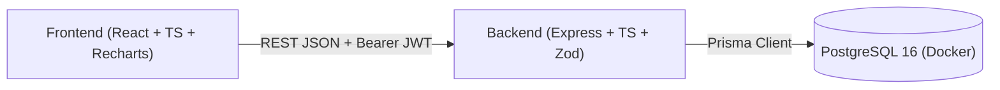

# FinPulse — Controle de Finanças Pessoais

Aplicação full-stack de **controle de finanças pessoais** construída com **React + TypeScript**, **Node.js + Express + TypeScript**, **Prisma ORM** e **PostgreSQL**, com autenticação **JWT**, gestão de contas, categorias, transações com filtros por período e dashboard analítico interativo com **Recharts**.

> Planejamento completo de produto, modelagem e etapas disponível em [PRD.md](./PRD.md).

---

## Principais Funcionalidades

- **Autenticação JWT Segura:** Cadastro (com criação automática de categorias iniciais), login, hash de senha com `bcryptjs`, middleware de proteção e isolamento estrito de dados por usuário.
- **Gestão de Contas e Carteiras:** CRUD completo de contas (Conta Corrente, Poupança, Cartão de Crédito, Dinheiro, Investimento) com **saldo atual calculado dinamicamente** (`saldo inicial + receitas - despesas`).
- **Categorias Personalizáveis:** Separação entre Receitas (`INCOME`) e Despesas (`EXPENSE`), com cores identificadoras refletidas nas badges e nos gráficos.
- **Transações com Filtros Combináveis:** CRUD completo com validação de integridade relacional, filtros por **mês/ano** ou **intervalo personalizado (`startDate`/`endDate`)**, tipo, conta, categoria, busca textual e paginação.
- **Dashboard Analítico (Recharts):**
  - Cards de KPIs (Saldo Consolidado, Receitas, Despesas, Balanço e Taxa de Economia).
  - Gráfico de barras **Receitas vs. Despesas** dos últimos 6 meses.
  - Gráfico donut **Despesas por Categoria** com barras proporcionais e percentuais.
  - Lista de transações recentes e resumo rápido das contas.

---

## Stack Tecnológica

| Camada | Tecnologias |
| :--- | :--- |
| **Frontend** | React 19, Vite, TypeScript, Tailwind CSS, Recharts, Lucide Icons, Axios, React Router |
| **Backend** | Node.js, Express, TypeScript, Zod, JWT (`jsonwebtoken`), `bcryptjs` |
| **Banco & ORM** | PostgreSQL 16 (Docker Compose), Prisma ORM + Migrations + Seed |
| **Testes** | Vitest + Supertest |

---

## Arquitetura do Projeto



```text
financial-control/
├── PRD.md                 # Product Requirements Document e roteiro de etapas
├── docker-compose.yml     # PostgreSQL 16 com volume persistente e healthcheck
├── backend/
│   ├── prisma/            # schema.prisma, migrations SQL e seed.ts
│   └── src/
│       ├── config/        # env e instância singleton do Prisma
│       ├── middlewares/   # ensureAuthenticated (JWT) e errorHandler
│       ├── modules/       # auth, accounts, categories, transactions, dashboard
│       └── __tests__/     # testes unitários e de integração (Vitest + Supertest)
└── frontend/
    └── src/
        ├── components/    # UI (shadcn-style), layout responsivo e modais
        ├── contexts/      # AuthContext e ToastContext
        ├── pages/         # Login, Register, Dashboard, Transactions, Accounts, Categories
        └── services/      # Cliente Axios com interceptors JWT
```

---

## Como Executar Localmente

### Pré-requisitos
- Node.js 20+ e npm
- Docker Desktop (para subir o PostgreSQL) **ou** uma URL de PostgreSQL local/nuvem (ex.: Neon, Supabase)

### 1. Subir o banco de dados PostgreSQL
```bash
docker compose up -d
```

### 2. Configurar e rodar o Backend
```bash
cd backend
cp .env.example .env
npm install
npx prisma generate
npx prisma migrate deploy
npm run prisma:seed
npm run dev
```
A API iniciará em `http://localhost:3333/api` (healthcheck em `GET /api/health`).

> **Credenciais do seed de demonstração:** `demo@finpulse.dev` / `123456` (com 6 meses de movimentações realistas).

### 3. Configurar e rodar o Frontend
Em outro terminal:
```bash
cd frontend
cp .env.example .env
npm install
npm run dev
```
Acesse a interface em `http://localhost:5173`.

---

## Testes e Build de Produção

```bash
# Testes automatizados do backend (Vitest + Supertest)
npm --prefix backend test

# Build TypeScript do backend
npm --prefix backend run build

# Build de produção do frontend
npm --prefix frontend run build
```

---

## Resumo dos Endpoints da API

- `GET /api/health` — Status da API
- `POST /api/auth/register` | `POST /api/auth/login` | `GET /api/auth/me`
- `GET|POST /api/accounts` | `PUT|DELETE /api/accounts/:id`
- `GET|POST /api/categories` | `PUT|DELETE /api/categories/:id`
- `GET|POST /api/transactions` | `PUT|DELETE /api/transactions/:id`
- `GET /api/dashboard/summary?month=11&year=2026`
